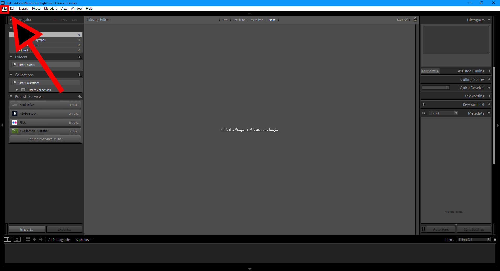
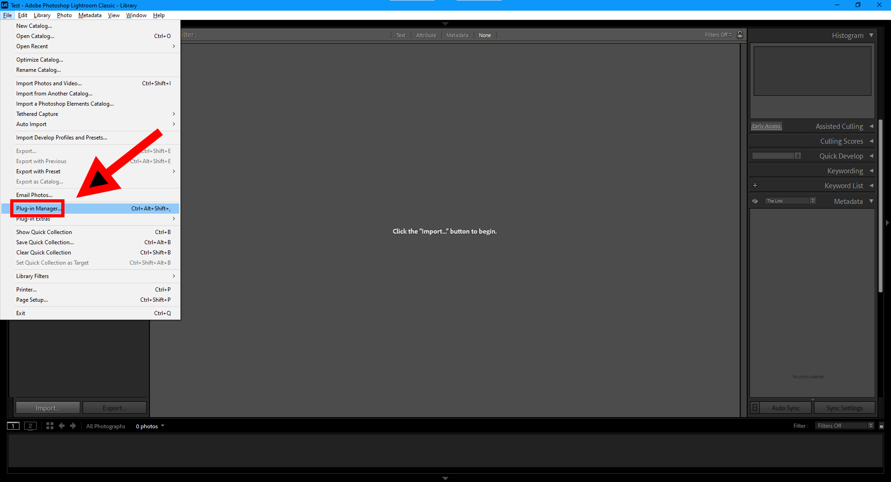
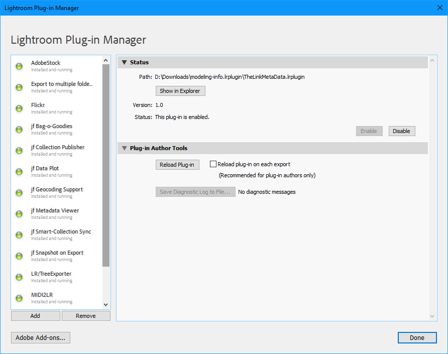
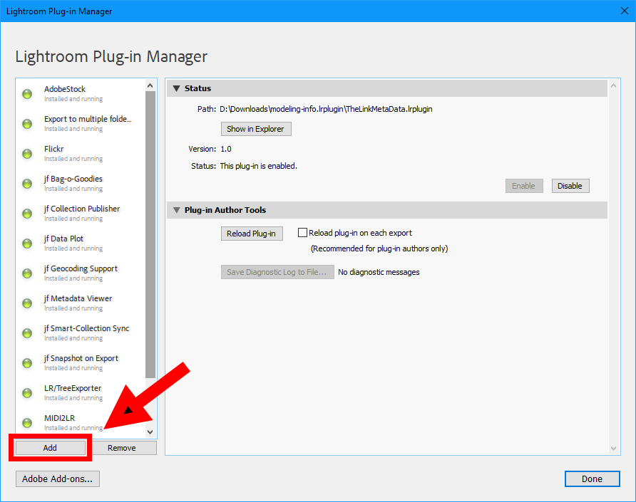

# Install Lightroom Plugins

## Windows

1. Open Lightroom

2. Click `File` in the top menu 

3. Click `Plugin Manager`

It should open this window.

4. Click `Add`

5. Find the downloaded plugin's folder and click `Select folder`

Your plugin should be installed now!

